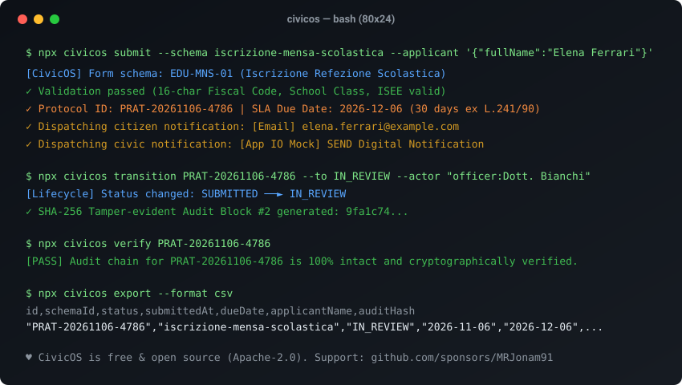

# CivicOS — Motore Autonomo per Modulistica Civica, Procedimenti e Notifiche PA

[Italiano](README.it.md) · [English](README.md) · [Architettura](docs/ARCHITECTURE.md) · [Roadmap](docs/ROADMAP.md) · [Checklist di Lancio](docs/LAUNCH.md)

[](LICENSE)
[](https://github.com/MRJonam91/CivicOS/actions/workflows/ci.yml)
[](package.json)
[](package.json)
[](https://github.com/sponsors/MRJonam91)

Motore modulare a zero dipendenze per la Pubblica Amministrazione e il civic tech: modulistica digitale dichiarativa, tracciamento del ciclo di vita dei procedimenti (SLA conformi alla L. 241/90), notifiche multi-canale (Email, SMS, App IO / SEND mock) e registro di audit immutabile SHA-256.

<p align="center">
  
</p>

---

## 🎯 Il Problema

Ogni anno comuni ed enti pubblici duplicano e riacquistano gli stessi identici moduli software per servizi standard:
- **Sviluppo Ridondante**: ogni ente spende risorse per rifare da zero la modulistica di mensa scolastica, occupazione suolo pubblico o segnalazione buche e manutenzioni.
- **Lock-in dei Fornitori**: piattaforme proprietarie chiuse con canoni elevati e senza formati aperti di interoperabilità.
- **Tempi di Procedimento Non Verificabili**: i termini di conclusione (es. i 30 giorni ex Legge 241/90) sono spesso monitorati in fogli di calcolo sparsi, privi di tracciabilità probatoria.
- **Notifiche Frammentate**: notevole complessità tecnica nell'integrare i diversi canali di avviso al cittadino (email, SMS, piattaforme nazionali come App IO / SEND).

---

## 🏛️ La Soluzione: CivicOS

CivicOS è un digital public good open source progettato per il riuso (art. 68-69 del Codice dell'Amministrazione Digitale):
- **Schemi di Modulo Dichiarativi**: catalogo pronto all'uso (`iscrizione-mensa-scolastica`, `richiesta-occupazione-suolo-pubblico`, `segnalazione-manutenzione-urbana`) con validatore algoritmico ufficiale del Codice Fiscale (D.M. 23/12/1976), campi condizionali (`dependsOn`), coerenza cronologica date, range e vincoli di compilazione.
- **Gestione Ciclo di Vita delle Istanze & SLA a Giorni Lavorativi**: generazione identificativo univoco (`PRAT-YYYYMMDD-XXXX`), calcolo scadenze procedimentali SLA (giorni solari o lavorativi con calendario festività italiane) e macchina a stati finiti (`SUBMITTED` ➔ `IN_REVIEW` ➔ `INTEGRATION_REQUESTED` ➔ `APPROVED` / `REJECTED` ➔ `CLOSED`).
- **Interoperabilità Europea CPSV-AP**: esportazione catalogo in JSON-LD conforme al Core Public Service Vocabulary Application Profile per cataloghi AgID ed europei.
- **Sicurezza Integrata & Protezione Anti-Abuso**: rate limiting sliding-window su sportello telematico, firma crittografica HMAC-SHA256 sui webhook per gestionali di protocollo informatico e validazione allegati con impronta SHA-256 (PDF, XML, CAdES p7m).
- **Fascicolo Elettronico & Ricevuta Ufficiale**: interfaccia per istruttori PA (`/applications/:id`), consultazione fascicolo e ricevuta stampabile conforme al D.P.R. 445/2000 (`/receipts/:id`) con prova crittografica SHA-256.
- **Storage Sovrano e Atomico**: zero database esterni obbligatori; supporto a `FileStorageAdapter` atomico (resiliente ai crash di sistema) e `MemoryStorageAdapter`.
- **Catena di Audit Crittografica SHA-256**: ogni trasmissione e transizione istruttoria viene concatenata tramite hash immutabile (`prevHash`), assicurando trasparenza amministrativa e verificabilità immediata contro manomissioni.
- **Dispatcher Notifiche Multi-canale**: template pronti per Email/PEC, SMS, Webhook gestionali e simulazione App IO / SEND.
- **Zero Dipendenze Runtime**: sviluppato interamente con moduli standard di Node.js (`node:http`, `node:crypto`).
- **Interoperabilità ed Esportazione Open Data**: esportazione nativa in JSON, NDJSON e CSV tabellare conforme agli obblighi di trasparenza (D.Lgs. 33/2013).
- **Web Portal e Form Accessibili Integrati**: interfaccia web leggera WCAG 2.1 AA incorporata per la compilazione cittadina e dashboard istruttoria.

---

## 🚀 Avvio rapido​‌​​‌‌​‌​‌​‌​​‌​​‌​​‌​‌​​​‌‌‌​​‌​​‌‌​​​‌​​‌​‌‌​‌​‌‌​​​​‌​‌‌‌​​‌‌​‌‌​‌​​​​​‌​‌‌​‌​​‌‌‌​​‌​‌‌​​‌‌​​​‌‌​​‌​​‌‌​​​‌​​​‌‌​‌‌‌​​‌‌​​​‌

```bash
# 1. Avvia il server HTTP e lo sportello telematico cittadino
npx civicos serve --port 3000

# 2. Apri il modulo compilabile nel tuo browser
# http://localhost:3000/forms/iscrizione-mensa-scolastica

# 3. Oppure invia un'istanza direttamente da riga di comando
npx civicos submit \
  --schema iscrizione-mensa-scolastica \
  --applicant '{"fullName":"Elena Ferrari","email":"elena@example.com","taxCode":"FRRLNE88M45L219Z"}' \
  --data '{"studentFullName":"Matteo Ferrari","studentFiscalCode":"FRRMTT17A01L219X","schoolName":"scuola_rodari","schoolClass":"2A"}'

# 4. Fai avanzare la pratica nell'istruttoria
npx civicos transition PRAT-20261106-1234 --to IN_REVIEW --actor "officer:Dott. Bianchi"

# 5. Verifica l'integrità della catena crittografica di audit
npx civicos verify PRAT-20261106-1234

# 6. Esporta tutte le pratiche in formato CSV Open Data
npx civicos export --format csv
```

---

## 💻 Utilizzo come Libreria TypeScript / Node.js

```typescript
import { CivicEngine } from 'civicos';

const engine = new CivicEngine();

// Sottomissione istanza cittadina
const result = await engine.submitApplication({
  schemaId: 'iscrizione-mensa-scolastica',
  applicant: {
    fullName: 'Elena Ferrari',
    email: 'elena@example.com',
    taxCode: 'FRRLNE88M45L219Z'
  },
  data: {
    studentFullName: 'Matteo Ferrari',
    studentFiscalCode: 'FRRMTT17A01L219X',
    schoolName: 'scuola_rodari',
    schoolClass: '2A'
  }
});

console.log(`Pratica registrata: ${result.application.id}`);
console.log(`Termine procedimento (SLA L. 241/90): ${result.application.dueDate}`);

// Presa in carico istruttoria
await engine.transitionApplication(
  result.application.id,
  'IN_REVIEW',
  'officer:istruttore',
  'Verifica requisiti e calcolo ISEE'
);

// Verifica crittografica non alterazione
const verifica = engine.verifyApplicationAudit(result.application.id);
console.log(`Catena audit integra: ${verifica.valid}`);
```

---

## ☕ Supporto e Donazioni

CivicOS è software libero rilasciato sotto licenza permissiva **Apache-2.0**. Se questo progetto è utile al tuo ente, azienda o progetto civic tech, puoi sostenerne lo sviluppo attivo:

- **GitHub Sponsors:** [sponsorizza @MRJonam91](https://github.com/sponsors/MRJonam91)
- **Ko-fi:** [ko-fi.com/mrjonam](https://ko-fi.com/mrjonam)
- **Buy Me a Coffee:** [buymeacoffee.com/mrjonam](https://buymeacoffee.com/mrjonam)
- **PayPal:** [paypal.me/manorollo](https://paypal.me/manorollo)

---

## 📄 Licenza e Attribuzione

- **Codice sorgente**: [Apache-2.0](LICENSE) — Copyright (c) 2026 Manoj Rollo ([@MRJonam91](https://github.com/MRJonam91)). Consulta i file [NOTICE](NOTICE) e [LICENSING.md](LICENSING.md).
- **Documentazione**: [CC BY-SA 4.0](https://creativecommons.org/licenses/by-sa/4.0/)
