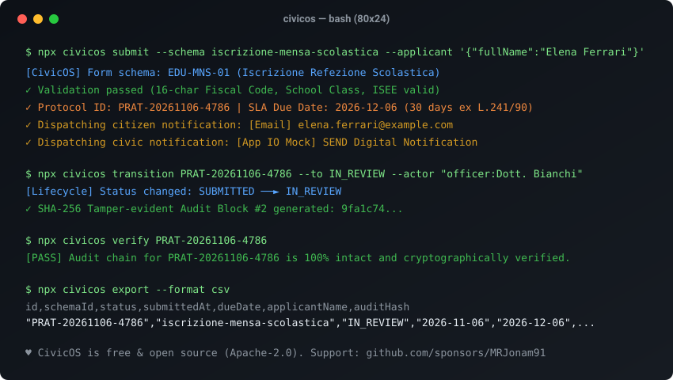

# CivicOS — Standalone Civic Forms, Procedures & Notifications Engine

[Italiano](README.it.md) · [English](README.md) · [Architecture](docs/ARCHITECTURE.md) · [Launch Checklist](docs/LAUNCH.md)

[](LICENSE)
[](https://github.com/MRJonam91/CivicOS/actions/workflows/ci.yml)
[](package.json)
[](package.json)
[](https://github.com/sponsors/MRJonam91)

Standalone, zero-dependency civic engine for public sector services: declarative digital forms, deterministic procedural lifecycle tracking (L. 241/90 compliant SLAs), multi-channel notifications (Email, SMS, App IO / SEND mock) and tamper-evident SHA-256 audit logging.

<p align="center">
  
</p>

---

## 🎯 The Problem

Public administrations and municipal bodies waste millions annually rewriting identical software modules for standard civic services:
- **Redundant Development**: Every council re-commissions bespoke digital forms for school meals, road maintenance, and public space permits.
- **Vendor Lock-in**: Rigid proprietary platforms with opaque fees and no open data portability.
- **Unverifiable Timelines**: Administrative SLA delays (e.g. Italian L. 241/90 30-day deadlines) tracked in scattered spreadsheets with zero tamper-evident audit trails.
- **Fragmented Notifications**: High friction in connecting citizen notices across SMS, email, and national notification platforms (App IO / SEND).

---

## 🏛️ The Solution: CivicOS

CivicOS is a sovereign, open source digital public goods module:
- **Declarative Form Schemas**: Rigorous schema catalog (`iscrizione-mensa-scolastica`, `richiesta-occupazione-suolo-pubblico`, `segnalazione-manutenzione-urbana`) with built-in validation for Italian fiscal codes (official D.M. 23/12/1976 checksum algorithm), conditional dependencies (`dependsOn`), chronological dates, ranges, and required fields.
- **Procedural Lifecycle Management & Business Day SLAs**: Automatic generation of unique procedural IDs (`PRAT-YYYYMMDD-XXXX`), calculation of legal SLA deadlines (calendar or Italian working days excluding national holidays), and deterministic state machine transitions (`SUBMITTED` ➔ `IN_REVIEW` ➔ `INTEGRATION_REQUESTED` ➔ `APPROVED` / `REJECTED` ➔ `CLOSED`).
- **European CPSV-AP Interoperability**: Native JSON-LD catalog export compliant with W3C / ISA2 Core Public Service Vocabulary Application Profile.
- **Security & Integrity Shield**: Sliding-window rate limiting on public forms, HMAC-SHA256 authenticated webhooks for electronic protocol registries, and cryptographic SHA-256 attachment verification (PDF, XML, CAdES p7m).
- **Official Protocol Receipt & Case Dossier**: Web case management interface (`/applications/:id`) and printable official electronic receipt (`/receipts/:id`) compliant with DPR 445/2000 legal declarations and cryptographic proof.
- **Sovereign Atomic Storage**: Zero external DB requirements; optional `FileStorageAdapter` with crash-resilient atomic writes or fast `MemoryStorageAdapter`.
- **Tamper-Evident Cryptographic Audit Chain**: Every citizen submission and administrative transition is permanently hashed and chained via SHA-256 (`prevHash`), providing undeniable transparency and auditability.
- **Multi-Channel Notification Dispatcher**: Native delivery templates for Email, SMS, Webhooks, and App IO / SEND mock.
- **Zero Runtime Dependencies**: Built entirely on standard Node.js libraries (`node:http`, `node:crypto`).
- **Interoperability & Open Data**: One-click export to standard JSON, streaming NDJSON, and tabular CSV (ready for D.Lgs. 33/2013 open government portals).
- **Embedded Web Portal**: Built-in accessible citizen submission forms and officer management dashboard.

---

## 🚀 Quick start​‌​​‌‌​‌​‌​‌​​‌​​‌​​‌​‌​​​‌‌‌​​‌​​‌‌​​​‌​​‌​‌‌​‌​‌‌​​​​‌​‌‌‌​​‌‌​‌‌​‌​​​​​‌​‌‌​‌​​‌‌‌​​‌​‌‌​​‌‌​​​‌‌​​‌​​‌‌​​​‌​​​‌‌​‌‌‌​​‌‌​​​‌

```bash
# 1. Start the embedded Web Portal & REST API server
npx civicos serve --port 3000

# 2. Open the accessible citizen form in your browser
# http://localhost:3000/forms/iscrizione-mensa-scolastica

# 3. Or submit an application directly via CLI
npx civicos submit \
  --schema iscrizione-mensa-scolastica \
  --applicant '{"fullName":"Elena Ferrari","email":"elena@example.com","taxCode":"FRRLNE88M45L219Z"}' \
  --data '{"studentFullName":"Matteo Ferrari","studentFiscalCode":"FRRMTT17A01L219X","schoolName":"scuola_rodari","schoolClass":"2A"}'

# 4. Advance application through administrative review
npx civicos transition PRAT-20261106-1234 --to IN_REVIEW --actor "officer:Dott. Bianchi"

# 5. Verify the cryptographic audit chain
npx civicos verify PRAT-20261106-1234

# 6. Export all applications to Open Data CSV
npx civicos export --format csv
```

---

## 💻 Programmatic Usage (Node.js SDK)

```typescript
import { CivicEngine } from 'civicos';

const engine = new CivicEngine();

// Submit an application
const result = await engine.submitApplication({
  schemaId: 'iscrizione-mensa-scolastica',
  applicant: {
    fullName: 'Elena Ferrari',
    email: 'elena@example.com',
    taxCode: 'FRRLNE88M45L219Z'
  },
  data: {
    studentFullName: 'Matteo Ferrari',
    studentFiscalCode: 'FRRMTT17A01L219X',
    schoolName: 'scuola_rodari',
    schoolClass: '2A'
  }
});

console.log(`Application created: ${result.application.id}`);
console.log(`Procedural SLA Due Date: ${result.application.dueDate}`);

// Move to next state
await engine.transitionApplication(
  result.application.id,
  'IN_REVIEW',
  'officer:clerk',
  'Document inspection started'
);

// Verify audit integrity
const verification = engine.verifyApplicationAudit(result.application.id);
console.log(`Audit chain valid: ${verification.valid}`);
```

---

## ☕ Support & Donations

CivicOS is 100% free software under the permissive **Apache-2.0** license. If this project helps your public body or civic tech workflow, consider supporting development:

- **GitHub Sponsors:** [sponsor @MRJonam91](https://github.com/sponsors/MRJonam91)
- **Ko-fi:** [ko-fi.com/mrjonam](https://ko-fi.com/mrjonam)
- **Buy Me a Coffee:** [buymeacoffee.com/mrjonam](https://buymeacoffee.com/mrjonam)
- **PayPal:** [paypal.me/manorollo](https://paypal.me/manorollo)

---

## 📄 License & Attribution

- **Source Code**: [Apache-2.0](LICENSE) — Copyright (c) 2026 Manoj Rollo ([@MRJonam91](https://github.com/MRJonam91)). See [NOTICE](NOTICE) and [LICENSING.md](LICENSING.md).
- **Documentation**: [CC BY-SA 4.0](https://creativecommons.org/licenses/by-sa/4.0/)
